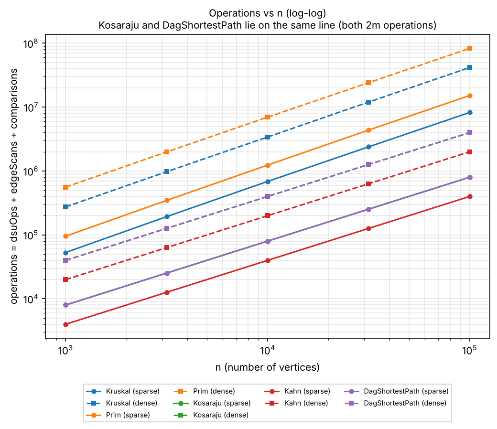
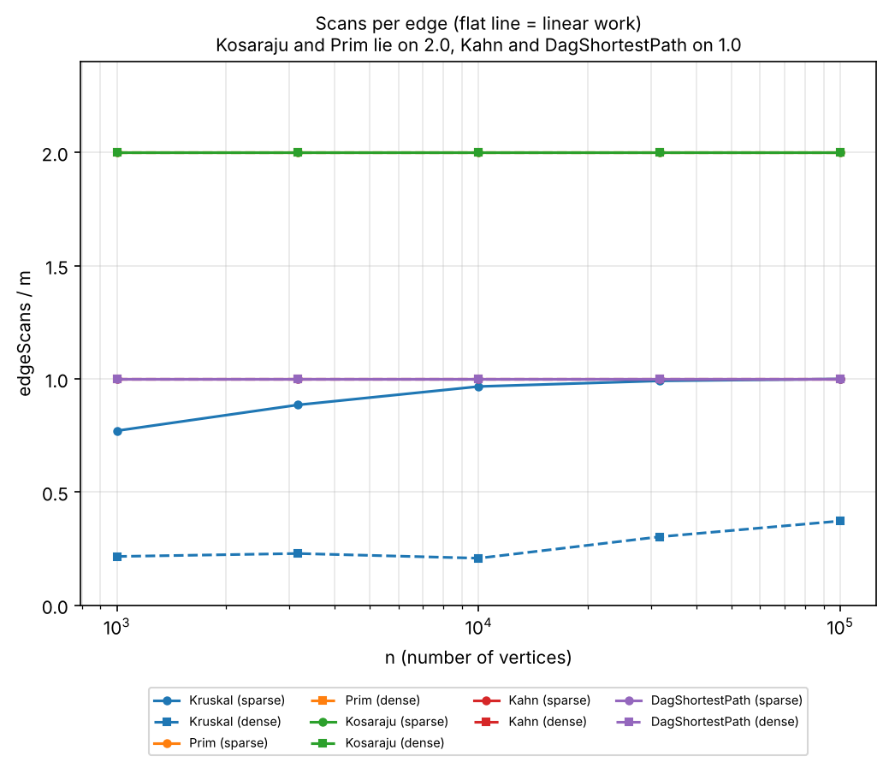
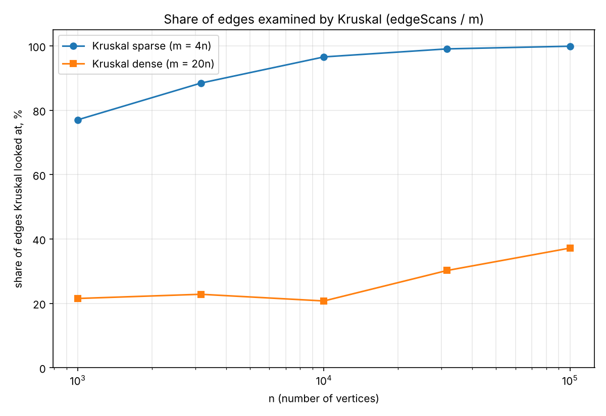

# Assignment 3 - Graphs: DSU, MST, SCC and Shortest Paths

**Design and Analysis of Algorithms**

## 1. Project Overview

This project implements a graph class using adjacency lists and supports both directed and undirected graphs. The implemented algorithms include Disjoint Set Union (DSU), Kruskal, Prim, Kosaraju, Kahn, and shortest paths in a Directed Acyclic Graph (DAG).

Operation counters (`dsuOps`, `edgeScans`, `comparisons`, `maxDepth`) are maintained within the algorithms.

The benchmark evaluates five algorithms across ten generated graph configurations, producing 50 rows in `results/results.csv`.

The benchmark validates the agreement between Kruskal and Prim, verifies topological ordering, checks expected edge scan counts, and compares results with the reference values.

All ten graph configurations produced the expected MST weights, SCC counts, and sums of DAG distances in the recorded results.

## 2. Complexity Table

Let V represent the number of vertices and E represent the number of edges.

| Algorithm | Time Complexity | Extra Space |
|---|---|---|
| DSU find / union | O(α(V)) amortized | O(V) |
| Kruskal | O(E log E) | O(V + E) |
| Prim (binary heap) | O(E log V) | O(V + E) |
| Kosaraju | O(V + E) | O(V + E) |
| Kahn | O(V + E) | O(V) |
| DAG Shortest Paths | O(V + E) | O(V) |

### Complexity Explanation

**DSU:** Union by rank reduces tree height, while path compression shortens paths during find operations. Together, these techniques provide amortized O(α(V)) time.

**Kruskal:** Sorting edges requires O(E log E), followed by DSU operations to construct the minimum spanning tree.

**Prim:** A priority queue selects minimum-weight candidate edges. Heap operations determine the O(E log V) complexity for the adjacency-list implementation.

**Kosaraju:** Two depth-first search passes process the vertices and edges. The reversed graph requires additional memory.

**Kahn:** The algorithm maintains vertex in-degrees and processes vertices using a queue. Each vertex and edge is processed a constant number of times.

**DAG Shortest Paths:** Topological sorting is followed by a single relaxation pass. Distance and parent arrays require O(V) additional space.

## 3. Counters vs. Theoretical Complexity

Operation counters provide a machine-independent method for evaluating algorithm performance.

The experiments use five graph sizes:

- 1,000
- 3,162
- 10,000
- 31,623
- 100,000

Two graph densities are considered: sparse graphs with E = 4V and dense graphs with E = 20V.

The following values represent measured operation counts divided by their theoretical complexity expressions.

| Ratio | Density | 1000 | 3162 | 10000 | 31623 | 100000 |
|---|---|---|---|---|---|---|
| Kosaraju edgeScans / (V+E) | Sparse | 1.600 | 1.600 | 1.600 | 1.600 | 1.600 |
| Kosaraju edgeScans / (V+E) | Dense | 1.905 | 1.905 | 1.905 | 1.905 | 1.905 |
| Kahn edgeScans / (V+E) | Sparse | 0.800 | 0.800 | 0.800 | 0.800 | 0.800 |
| Kahn edgeScans / (V+E) | Dense | 0.952 | 0.952 | 0.952 | 0.952 | 0.952 |
| DAG edgeScans / (V+E) | Sparse | 0.800 | 0.800 | 0.800 | 0.800 | 0.800 |
| DAG edgeScans / (V+E) | Dense | 0.952 | 0.952 | 0.952 | 0.952 | 0.952 |
| Prim edgeScans / (2E) | Both | 1.000 | 1.000 | 1.000 | 1.000 | 1.000 |
| Prim comparisons / (E log2 E) | Sparse | 1.829 | 1.865 | 1.895 | 1.921 | 1.934 |
| Prim comparisons / (E log2 E) | Dense | 1.825 | 1.847 | 1.866 | 1.878 | 1.890 |
| Kruskal comparisons / (E log2 E) | Sparse | 0.894 | 0.909 | 0.919 | 0.926 | 0.933 |
| Kruskal comparisons / (E log2 E) | Dense | 0.913 | 0.921 | 0.929 | 0.935 | 0.940 |
| Kruskal dsuOps / edgeScans | Sparse | 2.324 | 2.283 | 2.259 | 2.252 | 2.250 |
| Kruskal dsuOps / edgeScans | Dense | 2.232 | 2.219 | 2.241 | 2.166 | 2.134 |
| Kruskal dsuOps / E | Sparse | 1.791 | 2.019 | 2.182 | 2.232 | 2.248 |
| Kruskal dsuOps / E | Dense | 0.480 | 0.506 | 0.465 | 0.654 | 0.794 |

### Analysis

**Kosaraju, Kahn, and DAG Shortest Paths**

The ratios remain constant as graph size increases. Kosaraju scans 2E edges, while Kahn and DAG relaxation each scan E edges according to the defined counters.

These measurements support the expected O(V + E) complexity.

**Prim**

Prim scans each adjacency entry once, giving `edgeScans = 2E` for undirected graphs.

The number of comparisons increases according to heap operations. The normalized comparison ratios range approximately from 1.8 to 1.9, consistent with logarithmic heap overhead.

**Kruskal**

The comparison ratio relative to E log₂ E ranges from approximately 0.89 to 0.94.

These results are consistent with the expected O(E log E) sorting complexity.

The ratio `dsuOps / E` is not constant because the implementation stops when the spanning tree contains V−1 edges.

The ratio `dsuOps / edgeScans` remains approximately between 2.1 and 2.3.

Each examined edge requires two find operations, and successful unions contribute additional operations.

Therefore:

`dsuOps <= 2E + (V - 1)`

This supports an O(E) upper bound for the DSU work in the connected benchmark graphs.

## 4. Slope Analysis

A linear regression was applied to the logarithms of operation counts and graph sizes.

| Counter | Sparse | Dense |
|---|---|---|
| Kosaraju edgeScans | 1.000 | 1.000 |
| Kahn edgeScans | 1.000 | 1.000 |
| DAG edgeScans | 1.000 | 1.000 |
| Prim edgeScans | 1.000 | 1.000 |
| Kruskal edgeScans | 1.055 | 1.119 |
| Kruskal comparisons | 1.105 | 1.089 |
| Prim comparisons | 1.108 | 1.090 |

The traversal algorithms produce slopes of approximately 1.00, supporting linear scaling with graph size at fixed density.

Kruskal's edge scan slopes are approximately 1.06 for sparse graphs and 1.12 for dense graphs.

Its sorting comparisons have slopes around 1.09–1.10, reflecting the logarithmic factor in O(E log E).

Kruskal can terminate early once the spanning tree is complete, which affects the number of edges examined.

## 5. Correctness Arguments

### 5.1 Cut Property: Kruskal and Prim

A cut divides the vertices of a graph into two disjoint sets S and V \ S.

Consider a set of edges A contained in some minimum spanning tree, with no edges from A crossing the selected cut.

Let e be a minimum-weight edge crossing that cut.

The cut property states that adding e to A preserves the possibility of extending A to a minimum spanning tree.

To demonstrate this, consider a minimum spanning tree T containing A.

If T already contains e, the property holds.

Otherwise, adding e to T creates a cycle. This cycle must contain another edge f crossing the same cut.

Since e is a minimum-weight crossing edge, its weight cannot exceed the weight of f.

Replacing f with e produces another spanning tree whose total weight is no greater than that of T.

Therefore, the replacement also forms a minimum spanning tree containing A and e.

Kruskal applies this property by selecting the smallest available edge connecting two different DSU components.

Prim applies the same property by selecting the minimum-weight edge connecting the current tree to an unvisited vertex.

Both algorithms produce minimum spanning trees with equal total weight, although the selected edges may differ when weights are equal.

### 5.2 Induction on Topological Order: DAG Shortest Paths

The correctness of DAG shortest paths follows from induction on the topological ordering.

Consider a vertex v processed according to a valid topological order.

The claim is that its shortest distance is finalized when it is processed.

Initially, all vertices with in-degree zero have distance zero, corresponding to a virtual super-source.

These vertices form the base case because no incoming edges can improve their distances.

For the induction step, assume that the shortest distances of all previously processed vertices are correct.

Every incoming edge of v originates from a vertex appearing earlier in the topological order.

Therefore, all possible predecessors of v have already been processed.

Relaxing their outgoing edges ensures that the minimum possible distance to v has been considered.

Consequently, the distance of v is correct when its turn is reached.

Each edge requires only one relaxation after the topological order has been computed.

The resulting time complexity is O(V + E).

### 5.3 Negative Edge Weights

Negative edge weights are allowed in a DAG because directed cycles do not exist.

Consequently, negative cycles are impossible.

The topological order guarantees that all predecessors of a vertex are processed before that vertex.

In a general graph, negative cycles may make shortest-path distances undefined.

Dijkstra's algorithm also cannot generally handle negative edges correctly.

Bellman-Ford is suitable for general graphs with negative weights when no reachable negative cycle invalidates the shortest paths, with O(VE) time complexity.

## 6. Algorithm Selection

| Situation | Recommended Algorithm | Reason |
|---|---|---|
| Sparse graph, edge list | Kruskal | Sorting edges and using DSU is convenient |
| Sparse graph, adjacency list | Kruskal or Prim | Both have efficient implementations |
| Dense graph, adjacency matrix | Prim with array | O(V²) implementation avoids sorting all edges |
| Disconnected undirected graph | Kruskal or Prim | Both can construct a minimum spanning forest |
| MST construction from a starting vertex | Prim | Expands a tree from the selected vertex |
| Pre-sorted edges | Kruskal | Sorting overhead can be reduced |
| Strongly connected components | Kosaraju | Linear-time SCC detection |
| Job scheduling with dependencies | Kahn | Provides topological ordering and cycle detection |
| Shortest paths in a DAG | Topological relaxation | O(V + E), supports negative weights |
| General shortest paths | Dijkstra or Bellman-Ford | Selection depends on edge weights |

### Kruskal and Prim Comparison

The experiments also measured the fraction of edges examined by Kruskal.

For sparse graphs, the fraction increases from approximately 0.77 at V = 1,000 to 0.999 at V = 100,000.

For dense graphs, the fraction increases from approximately 0.21 to 0.37.

Kruskal can complete the spanning tree before examining all sorted edges.

Prim, in comparison, scans all adjacency entries.

According to the recorded operation counters, Prim required approximately 1.8–1.85 times the total counted operations of Kruskal on sparse graphs and 2.0–2.05 times on dense graphs.

These results describe the tested implementations and graph configurations rather than a universal performance ranking.

## 7. Experimental Plots

### Plot 1. Operations vs. Graph Size

This plot compares total counted operations against the number of vertices using logarithmic axes.

The operation total combines DSU operations, edge scans, and comparisons.

The curves illustrate how algorithmic work increases with graph size.

Kosaraju and DAG Shortest Paths have matching totals under the recorded counter definitions.

### Plot 2. Edge Scans per Edge

This plot shows the ratio `edgeScans / E`.

Kosaraju and Prim maintain a ratio of 2.0.

Kahn and DAG Shortest Paths maintain a ratio of 1.0.

These constant ratios support the expected linear traversal behavior.

Kruskal does not produce a constant ratio because it can terminate before examining every edge.

### Plot 3. Kruskal Edge Examination

The third plot compares the fraction of edges examined by Kruskal in sparse and dense graphs.

The measurements demonstrate how early termination influences the algorithm's operation count.

## 8. Stack Safety

Kosaraju uses an explicit array-based stack instead of recursive depth-first search.

This prevents dependency on the JVM call-stack depth when processing large graphs.

At V = 100,000, the recorded maximum stack depths were:

| Graph Density | Maximum Depth |
|---|---|
| Sparse | 59,668 |
| Dense | 91,920 |

Additional JUnit tests evaluate a directed path containing 100,000 vertices and a directed cycle of the same size.

For the directed path, the maximum explicit stack depth reaches 100,000.

The iterative implementation is designed to complete these traversals without `StackOverflowError`.

## 9. Execution Time Analysis

Execution time was measured using the median of five runs.

The measurements are stored in `results/results.csv` under the `time_ms` column.

For a graph with V = 100,000 and E = 2,000,000, one recorded benchmark run produced approximately:

| Algorithm | Execution Time |
|---|---|
| Kruskal | 1,300 ms |
| Prim | 2,600 ms |
| Kosaraju | 900 ms |
| Kahn | 84 ms |
| DAG Shortest Paths | 161 ms |

For smaller graphs, execution times were approximately 1–11 ms.

These measurements may be affected by JVM warm-up, garbage collection, operating system activity, and hardware characteristics.

Therefore, operation counters provide the primary evidence for complexity analysis.

The operation counts remain reproducible with the fixed graph generator, while execution times may vary between runs.

## 10. Implementation Notes and Limitations

The Kahn implementation counts edges processed when vertices are removed from the queue.

The initial pass used to calculate in-degrees is not included in the `edgeScans` counter.

This counter definition produces exactly E recorded edge scans.

The DAG shortest-path implementation performs topological ordering internally.

The internal Kahn counters are not added to the shortest-path counters, so the reported `edgeScans` measures the relaxation pass.

The optional bonus algorithms, including Tarjan's SCC algorithm, condensation graph construction, and critical path analysis, are not included.

## 11. Conclusion

The project implements and evaluates fundamental graph algorithms for connectivity, minimum spanning trees, strongly connected components, topological sorting, and shortest paths.

Correctness is evaluated through automated tests, reference comparisons, and cross-validation between algorithms.

The experimental operation counters are consistent with the expected theoretical complexity classes.

The comparison of Kruskal and Prim demonstrates how graph representation, density, and implementation details influence practical performance.

The iterative Kosaraju implementation supports large graph traversals without recursive stack limitations.

Overall, the results demonstrate the relationship between theoretical algorithm analysis and experimental performance measurements.